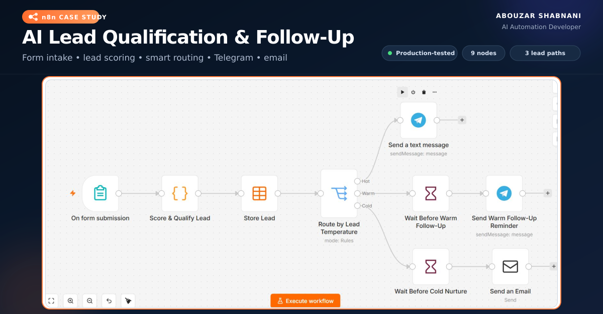

# AI Lead Qualification & Follow-Up Automation

**Portfolio navigation:** [Selected AI & Automation Projects](PORTFOLIO.md) · [Importable n8n workflow](AI-Lead-Qualification-Public-Template.json)

**For prospective clients:** This implementation demonstrates transparent lead scoring, persistent n8n Data Table records, Telegram notifications, and scheduled follow-up paths. The public template needs service credentials and setup before deployment; see the configuration steps below.

An inspectable n8n workflow portfolio project by **Aboozar Shabnani**. Integration testing and deployment depend on the credentials and services configured in the target n8n environment.

## Business problem

Agencies often receive leads from forms but respond slowly, qualify them inconsistently, and lose opportunities during manual follow-up. This workflow captures every request, calculates a lead score, stores the result, and routes each lead to an appropriate follow-up path.

## Workflow overview

1. An agency prospect submits the automation-audit form.
2. A transparent JavaScript scoring engine evaluates lead volume, budget, urgency, business pain, and company identity.
3. The complete lead record is stored in an n8n Data Table.
4. A Switch node classifies the lead:
   - **Hot (70–100):** immediate Telegram alert.
   - **Warm (45–69):** Telegram follow-up reminder after 24 hours.
   - **Cold (0–44):** nurture email after 7 days.

## Included nodes

- n8n Form Trigger
- Code node for deterministic lead scoring
- Data Table storage
- Switch routing with Hot, Warm, and Cold outputs
- Telegram notifications
- Wait nodes for delayed follow-up
- SMTP email nurture

## Privacy and security

The public workflow JSON contains no passwords, bot tokens, credential IDs, personal email address, Telegram Chat ID, n8n instance ID, production form identifier, pinned test submissions, or internal Data Table ID. Credentials must be created locally after import.

## Required Data Table

Create a Data Table named `agency_leads` with these columns before configuring the **Store Lead** node:

| Column | Type |
| --- | --- |
| `full_name` | String |
| `work_email` | String |
| `company_name` | String |
| `website` | String |
| `monthly_leads` | String |
| `main_challenge` | String |
| `automation_budget` | String |
| `implementation_timeline` | String |
| `contact_consent` | Boolean |
| `lead_score` | Number |
| `lead_temperature` | String |
| `priority` | String |
| `recommended_action` | String |
| `qualification_reasons` | String |
| `submitted_at` | Date & Time |
| `scored_at` | Date & Time |

Keep the system-generated `id`, `createdAt`, and `updatedAt` columns.

## Configuration after import

1. Import `AI-Lead-Qualification-Public-Template.json` into n8n.
2. Open **Store Lead** and select the `agency_leads` Data Table.
3. Create or select a Telegram Bot credential in both Telegram nodes.
4. Replace `YOUR_TELEGRAM_CHAT_ID` in both Telegram nodes with the destination Chat ID.
5. Create or select an SMTP credential in **Send an Email**.
6. Replace `Your Name <you@example.com>` with the verified sender name and email.
7. Save and publish the workflow, then use the Form Trigger's Production URL.

Never paste a Telegram token, SMTP password, or Google App Password into a public workflow export.

## Lead-scoring model

| Signal | Maximum points |
| --- | ---: |
| Monthly lead volume | 30 |
| Automation budget | 30 |
| Implementation timeline | 25 |
| Clear operational pain | 15 |
| Identifiable company and website | 5 |

The score is capped at 100. The scoring rules are transparent and can be adjusted inside **Score & Qualify Lead**.

## Acceptance tests

### Hot test

- Monthly leads: `101-300`
- Budget: `$1,500-$5,000`
- Timeline: `Within 30 days`
- Challenge: `We respond slowly, handle leads manually, and lose qualified leads before follow-up.`
- Company and website supplied

Expected result: score about 90, immediate Telegram alert, and a stored table row.

### Warm test

- Monthly leads: `21-50`
- Budget: `$500-$1,500`
- Timeline: `Within 3 months`
- A detailed challenge containing words such as `manual`, `slow`, or `lose`
- Company and website supplied

Expected result: score about 55 and a Telegram reminder after 24 hours.

### Cold test

- Monthly leads: `0-20`
- Budget: `Under $500`
- Timeline: `Just exploring`
- Website left empty

Expected result: score below 45 and a nurture email after 7 days.

For delay testing, temporarily change a Wait node to one minute, verify the result, and restore the production delay before publishing.

## Technology

`n8n` · `JavaScript` · `Data Tables` · `Telegram Bot API` · `SMTP` · `Docker` · `Cloudflare Tunnel`

## Commercial upgrade ideas

- CRM integration with HubSpot, Pipedrive, or Airtable
- AI-generated lead summaries and personalized replies
- Calendar booking for qualified leads
- Duplicate detection and lead-status tracking
- Error alerts and execution monitoring
- Conversion reporting dashboard
